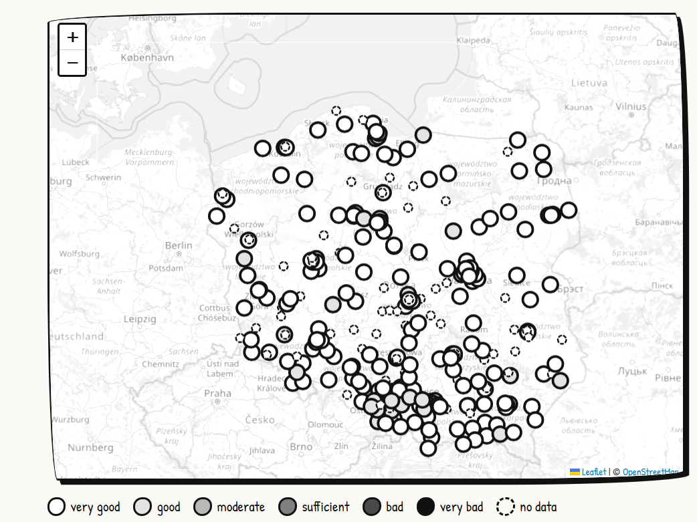
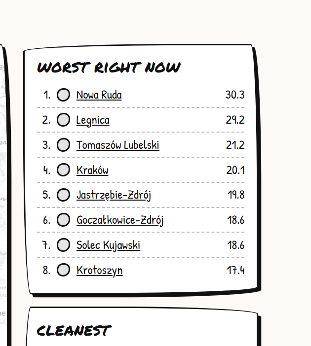
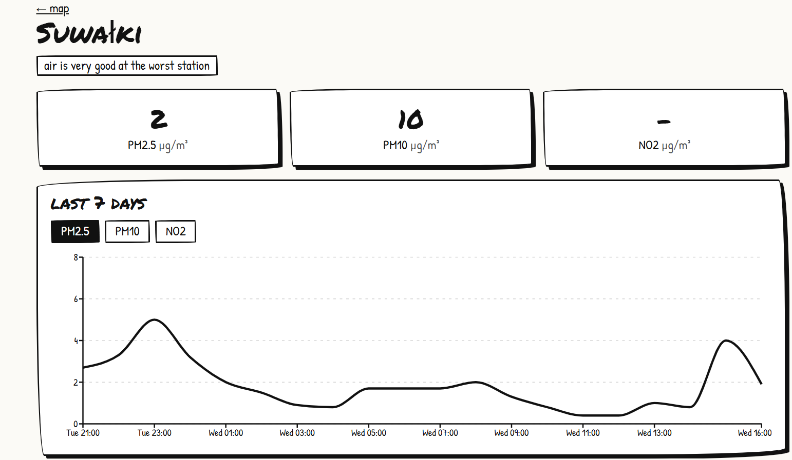
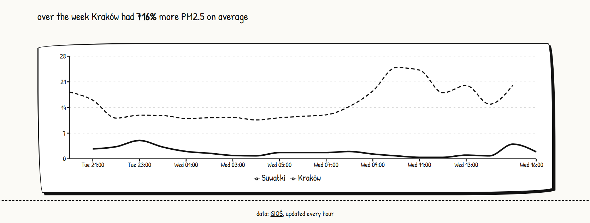

# smog map

Every winter in Poland the air gets bad and checking it means opening the GIOŚ site, finding your station on a tiny map and clicking through tables. I wanted something quicker: one map for the whole country, a page per city with the last week, a way to compare two cities, and an email when it gets bad near me.

Data comes from the public GIOŚ API and gets refreshed every hour.



## What's in it

- map of all stations, the darker the dot the worse the air (black and white on purpose)
- worst and cleanest cities right now

  

- city page with current PM2.5 / PM10 / NO₂, a 7 day chart and a table of stations

  

- comparing two cities over the week

  

- email alerts: pick a spot on the map, a radius and a limit, you get an email when PM2.5 nearby goes above it (max once every 6h)

## Stack

backend: Python 3.10+, FastAPI, SQLAlchemy 2, SQLite, httpx, pytest

frontend: Next.js 15 (app router), React 19, TypeScript in strict mode, react-leaflet, Recharts

Frontend types are generated from FastAPI's OpenAPI schema (`openapi-typescript`). So when I change a response model in Python, `npm run gen:api` updates the types and the frontend doesn't build until I fix whatever broke. Caught a couple of things this way already.

## How it works

```
GIOŚ API --(every hour)--> sync --> SQLite --> FastAPI --> Next.js
                             |
                             +--> check subscriptions --> email
```

- on first start (and then every night at 3) it loads the station list and the sensors. I only keep PM2.5, PM10 and NO₂
- every hour it pulls the latest readings for each sensor and upserts them. Anything older than 30 days is deleted
- GIOŚ sometimes drops connections when you send a lot of requests, so there's a small concurrency limit and retries. Some sensors return 400, those are just inactive ones
- index levels follow the GIOŚ thresholds, a station gets the level of its worst pollutant
- pages are rendered on the server and revalidated every 10 min. The map is client only because Leaflet needs `window`

## Running locally

backend

```bash
cd backend
python -m venv .venv
.venv\Scripts\activate        # windows
# source .venv/bin/activate   # mac / linux
pip install -r requirements.txt
cp .env.example .env
uvicorn app.main:app --reload
```

the first sync takes a few minutes (around 800 requests). Swagger is at http://localhost:8000/docs

frontend (needs the backend running)

```bash
cd frontend
npm install
cp .env.example .env.local
npm run gen:api
npm run dev
```

then http://localhost:3000

tests

```bash
cd backend
pytest
```

## API

| | | |
|---|---|---|
| GET | `/stations` | all stations with latest values |
| GET | `/stations/near?lat=&lon=&limit=&radius_km=` | closest stations |
| GET | `/stations/{id}` | one station |
| GET | `/stations/{id}/history?param=PM2.5&days=7` | hourly history |
| GET | `/cities` | list of cities |
| GET | `/cities/ranking?param=PM2.5&order=worst` | worst / cleanest now |
| GET | `/cities/{name}?days=7` | stations and history for a city |
| GET | `/compare?a=&b=&param=` | two cities |
| POST | `/subscriptions` | subscribe to alerts |
| DELETE | `/subscriptions/{token}` | unsubscribe |

## Emails

If `SMTP_HOST` is empty alerts just go to the log. For real emails fill the SMTP vars in `backend/.env`, I tested with Mailtrap.

## Todo

- postgres for deploy
- docker compose
- forecast
- the compare text says things like "716% more", should probably say "8x" for big differences

## Data sources

- air quality measurements and station list: [Główny Inspektorat Ochrony Środowiska (GIOŚ)](https://powietrze.gios.gov.pl), via the public [GIOŚ API](https://powietrze.gios.gov.pl/pjp/content/api). The hourly data is not verified yet (GIOŚ validates it later), so numbers can change or disappear
- air quality index thresholds: the Polish air quality index published by GIOŚ (described on [powietrze.gios.gov.pl](https://powietrze.gios.gov.pl))
- map tiles: © [OpenStreetMap](https://www.openstreetmap.org/copyright) contributors, data under ODbL. Tiles are from the OSM standard tile server, which has a [usage policy](https://operations.osmfoundation.org/policies/tiles/), so for anything with real traffic you should switch to another tile provider

## Licenses

The code in this repo is MIT, see [LICENSE](LICENSE).

Third party stuff it uses:

| | license |
|---|---|
| FastAPI, Pydantic, SQLAlchemy | MIT |
| httpx, uvicorn | BSD-3-Clause |
| pytest | MIT |
| Next.js, React, Recharts, openapi-typescript | MIT |
| TypeScript | Apache-2.0 |
| Leaflet | BSD-2-Clause |
| react-leaflet | Hippocratic License 2.1 |
| Patrick Hand font | SIL Open Font License 1.1 |
| Permanent Marker font | Apache-2.0 |

react-leaflet is not MIT, it uses the Hippocratic License, worth knowing if you reuse this somewhere commercial.
